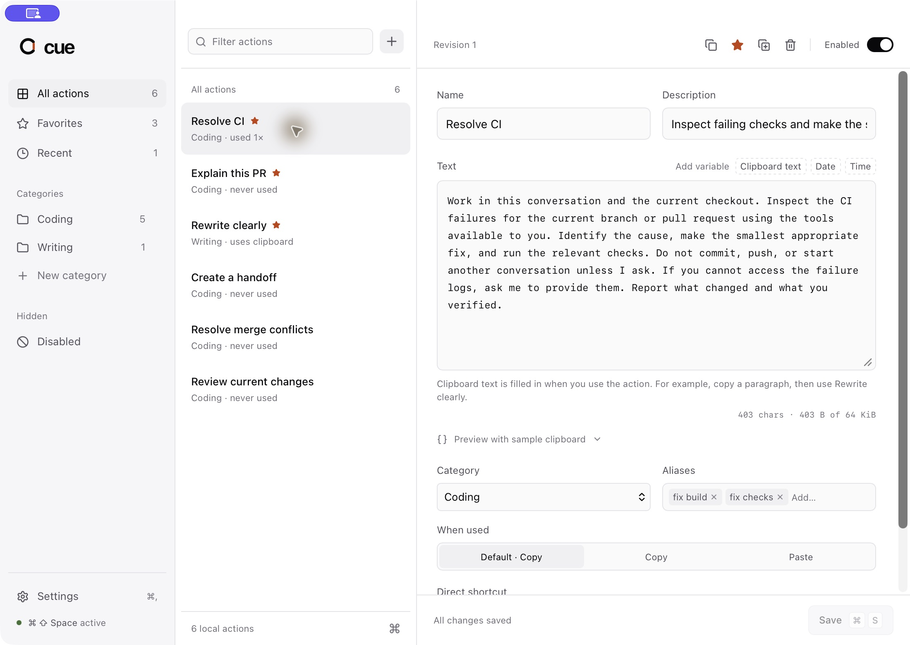

# Cue

Your prompts, on cue. A local desktop prompt launcher built with Tauri 2, React, TypeScript, Vite, and Rust. The interface follows the supplied [Cue design reference](https://claude.ai/artifact/VU7effrv5yrZYtfqvynTtj#page-3f2a63797740).

Cue defaults to Paste on macOS. It captures the previous app, window, and focused field before opening the palette, then returns there and sends one ⌘V after permission, focus, modifier, and clipboard checks. Accessibility permission is required. Shift+Enter copies instead. Windows, Linux, and the browser preview currently support Copy. Cue never sends Enter to the target app or executes prompt text. Automatic paste is verified in J4 Code; broader native acceptance testing is still pending.



## Run

Install Node.js 22 or newer, Rust, and the [Tauri prerequisites](https://v2.tauri.app/start/prerequisites/). Dependencies are locked in `package-lock.json` and `src-tauri/Cargo.lock`.

```sh
npm ci
npm run desktop
```

`npm run dev` opens the browser preview at `http://127.0.0.1:1420`. It supports editing, search, templates, import/export, and manual clipboard copying. It uses a separate IndexedDB library. Global shortcuts, the menu bar, and launch at login require the desktop app.

```sh
npm run build
npm test
npm run test:native-paste
cargo test --manifest-path src-tauri/Cargo.toml --locked
cargo clippy --manifest-path src-tauri/Cargo.toml --locked --all-targets -- -D warnings
npm run package:mac
```

Use `npm run package:mac` on macOS with Python 3 and a valid Developer ID Application certificate installed. The script selects the sole developer identity in the keychain; set `APPLE_SIGNING_IDENTITY` to a certificate name or SHA-1 fingerprint when several developers are present. It verifies the app signature before using pinned `dmgbuild` dependencies to create the drag-to-Applications layout. Unsigned installers are rejected because their identity changes on rebuild and invalidates Accessibility access. Use `--bundles nsis` on Windows and `--bundles appimage,deb` on Linux after the corresponding native compatibility tests. The CI workflow checks and builds all three targets; a successful build alone does not establish OS integration support.

The macOS DMG contains Cue and an Applications shortcut. Drag Cue onto Applications, then open it from Applications. Installing a new app bundle preserves the existing Cue library in Application Support; it does not reset onboarding or delete saved actions.

## Implemented

- Onboarding with optional editable starter actions. Setup commits its actions and settings in one transaction and runs once.
- A warm separate palette window. It has search, arrow-key selection, Enter, Shift+Enter, Escape, action menus, and a saved-text preview.
- A library and explicit-save editor. Create, duplicate, disable, delete, favorite, categorize, and alias actions. Closing to the menu bar preserves the unsaved editor. Navigating away or quitting with unsaved changes requires a discard decision. Typing, variable insertion, selection replacement, and Tab indentation use the text field's native undo/redo history.
- Name/alias/tag/category search with accent-insensitive normalization and deterministic ranking. Prompt bodies are excluded from search.
- One-pass `{{clipboard}}`, `{{date}}`, and `{{time}}` substitution. Other placeholders, including `@{{upstream}}`, stay literal. Escaping applies only to the three supported variables. Unicode, indentation, byte limits, and prohibited control characters are validated in Rust.
- A Rust-owned SQLite database on a dedicated worker. Writes are transactional. Editor/import revisions protect against stale changes. Unsupported or damaged databases are not silently reset.
- Native clipboard copying, serialized delivery, consumed/expiring palette invocations, library idempotency, and key-repeat suppression.
- Configurable palette and direct-action global shortcuts. Requested and active bindings are distinct. Failed replacement preserves the prior working binding.
- Strict JSON import previews and atomic commits. Imports reset delivery to Copy and remove shortcuts. Backups use SQLite's online backup API, retaining five files.
- JSON export, recent-use counters, clear-usage confirmation, system/light/dark themes, tray access, single-instance handling, and optional launch at login.
- Separate window permissions, caller checks, bundled assets, a restrictive CSP, blocked remote navigation, and disabled release developer tools.

## Local data

Release data lives in the OS application-data directory for `app.cue.launcher`. Debug builds use `app.cue.launcher.dev` data, separate from release data. On macOS, these directories are under `~/Library/Application Support/`.

The database is `cue.sqlite3`. Backups live in `backups/` inside that data directory. Action text, exports, and backups are readable local files. Live clipboard text is never persisted by Cue. Usage counts mean that text was copied, not that a task succeeded.

The original specification is preserved at [docs/quick-actions-spec.md](docs/quick-actions-spec.md). Stored starter prompts are content for the receiving app, not instructions to the implementation process.

The macOS paste regression suite runs the actual native adapter against a controlled Accessibility server and pasteboard. It checks inactive-app focus changes, activation, exact target matching, permission and session loss, clipboard changes, and modifier release. It posts no real input and needs no Accessibility grant. Native end-to-end checks remain separate.

The **Clipboard text** button inserts `{{clipboard}}` at the text cursor. When you use the action, Cue replaces that placeholder with the plain text then on your clipboard. For example, copy a paragraph and use Rewrite clearly to include it in the prompt. The editor button does not read or paste the clipboard. Tags are no longer exposed in the editor; existing tag data is preserved for import/export compatibility.

## Release status

See [platform evidence](docs/platform-support.md), [manual checks](docs/manual-test-checklist.md), and [release instructions](docs/release-process.md). macOS target capture, focus restoration, paste injection, and copy-only recovery messages are implemented. macOS installers are Developer ID signed. Automatic paste is verified in J4 Code. Broader native acceptance testing and per-app preference controls remain pending. Windows/Linux runtime checks, Windows signing, macOS notarization, screen-reader coverage, and performance acceptance measurements are pending. Do not market this build as the full V1 specification.

Closing the library keeps Cue running in the menu bar by default. Background login launches stay hidden. Use the shortcut for the palette, Manage Actions in the menu bar for the library, and Quit Cue to stop the process. The schema-2 migration backs up the existing library, switches the former prototype defaults to Paste and keep-running, and preserves action overrides.
